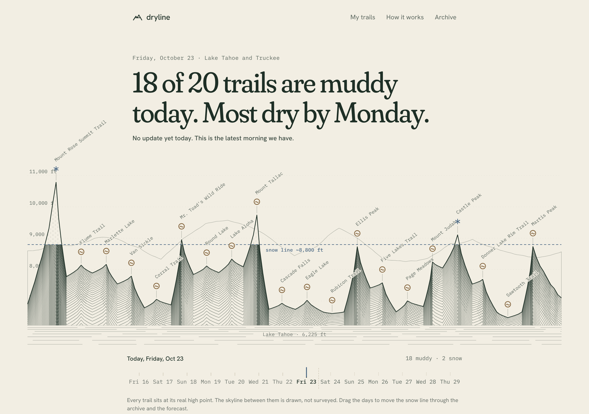
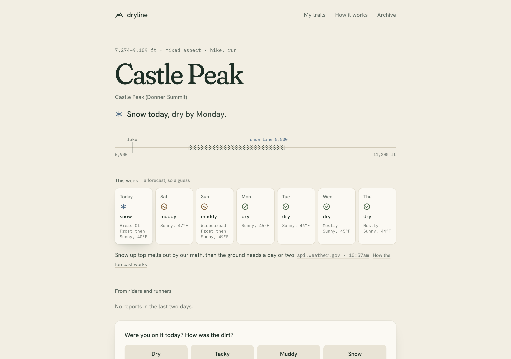
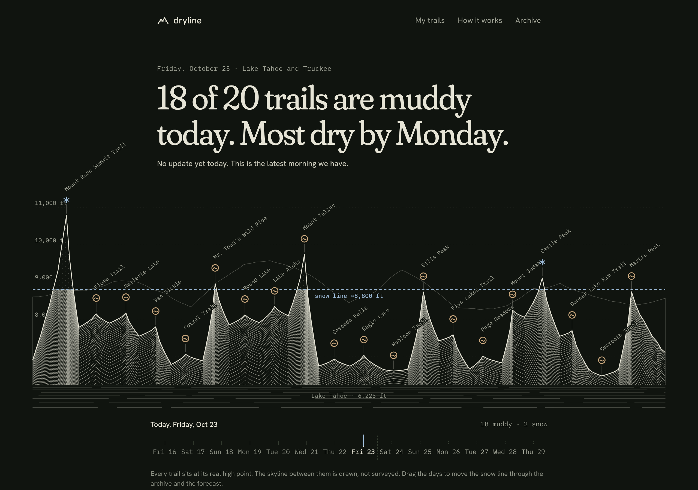
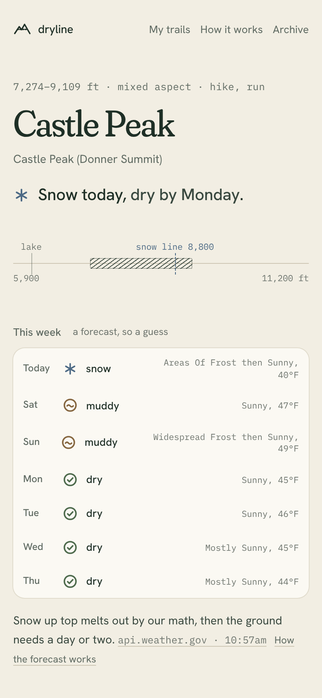

# dryline

When will my trail be dry? A daily forecast for 20 Lake Tahoe and Truckee trails: today's call, the day each muddy or snowy one should dry out, and a way for riders to say how it actually was.

**Live:** [dryline.brycerambach.com](https://dryline.brycerambach.com)



| Light | Dark | Phone |
|---|---|---|
|  |  |  |

## Why

Every fall and spring I have the same question before a ride: is it dry yet, and if not, when? Riding wet dirt wrecks trails, so it's not just about my bike. Surfers have Surfline for this exact shape of problem. Trail people have Facebook groups and guessing.

The data to answer it is public. SNOTEL stations report snow depth every day, airport sensors and SNOTEL gauges report rain, NWS forecasts the week. Nobody turns it into "Mr. Toad's dries Saturday".

## What it does

- **Today's call** for each trail: dry, muddy, snow, closed, or unknown. Fixed rules on public data, no AI, and every reason links its source and fetch time. If the data isn't there, it says unknown and what's missing.
- **A dry-by day.** Starting from today's call, a small water budget runs the NWS forecast forward. Snow at the high point melts with warm days, rain and meltwater soak the tread, sun and a south face dry it. It's a guess and the page says so.
- **The ridge.** The basin drawn as one ink engraving with every trail at its real high point and the snow line across it. Drag the days under it and the snow line moves through the archive and the week ahead.
- **Rider reports.** Ten seconds at the trailhead: dry, tacky, muddy or snow, plus a note. No account. Reports show on the trail for two days and become the labels the forecast gets scored against.
- **My trails and a morning email.** Pick the ones you ride. They go to the top of the page, and you can get one short note each morning: "2 of your 3 are dry. Big Meadow dries tomorrow."
- **A published hit rate.** How it works shows how often the forecast matched the next mornings' calls.

## Status

Early, and honest about it.

- The archive starts Oct 16, 2026. The forecast has only seen one storm, so the hit rate is a small sample.
- The 20 trails are drafts until reviewed (`confirmed: false` in `trails.yaml`, checklist in `docs/TRAILS_REVIEW.md`).
- Rider reports and the morning email need a storage store and an email key connected in Vercel. Until then the site says reports open soon and the email form says it isn't on yet.
- Tahoe only. SNOTEL, NWS and METAR cover the whole western US, so the rules don't care where a trail is. More areas come after the forecast earns trust here.

Not safety advice. Check the land manager before you go.

## Run it

```sh
uv sync
uv run dryline collect   # fetch today's sources into data/raw/YYYY-MM-DD/ (network)
uv run dryline build     # rules + forecast -> data/lines, data/outlook -> site/
uv run dryline eval      # score hand labels; --reports scores archived rider reports
uv run dryline label     # local labeling page at http://127.0.0.1:8765
uv run pytest            # offline tests (sockets blocked)
```

The API (`api/`, Node on Vercel) is small: `POST /api/report`, `GET /api/reports`, `POST /api/subscribe` with a confirm link, one-click unsubscribe, and a 7:30am cron that sends the morning notes. `.github/workflows/daily.yml` collects and builds at 6:40am Pacific and commits the snapshot; Vercel deploys from that commit.

## How it decides

The rules in `src/dryline/rules.py` are fixed and deterministic. Precedence is closed > snow > muddy > dry > unknown.

- **Closed:** an official alert (USFS, NV State Parks) or TRTA entry names the trail and a closure.
- **Snow:** a SNOTEL station within 40 km and ±1,000 ft of the trail's elevation range reports ≥ 2 in of snow at or below the trail's high point.
- **Muddy:** ≥ 0.25 in of precipitation in 48 h at the nearest SNOTEL gauge or METAR station.
- **Dry:** needs positive evidence on both counts. A similar-elevation station must show no snow, and the precipitation record must be complete and low.
- **Stale data** counts as missing: 2 days for SNOTEL, 6 h for NWS observations, 14 days for a conditions page.

The forecast lives in `src/dryline/forecast.py`. Every constant in it is named and commented, so when the eval says it's wrong we can see which number to move.

## FAQ

**Why not use AllTrails or Strava reports?** Their terms don't allow it, and I'd rather build the reports in than scrape someone else's.

**Why does it say unknown so much?** Because a confident wrong answer is worse than none. If a station is stale or a page changed shape, dryline says so instead of guessing.

**Is the skyline real?** The trails' heights, the snow line and the lake level are. The rock between trails is drawn, and the caption says so.

**Can it cover my area?** Not yet. The data covers the western US, so it's mostly a matter of trail lists and land manager pages.

## Files

- `trails.yaml`, `stations.yaml`, `nws_grid.yaml`: the trails, SNOTEL stations, and NWS gridpoints.
- `SOURCES.md`: every source, its robots.txt and terms, and whether it's used.
- `docs/DESIGN.md`: how the design taste was applied. `PLAN.md` and `PROGRESS.md`: milestones and evidence.
